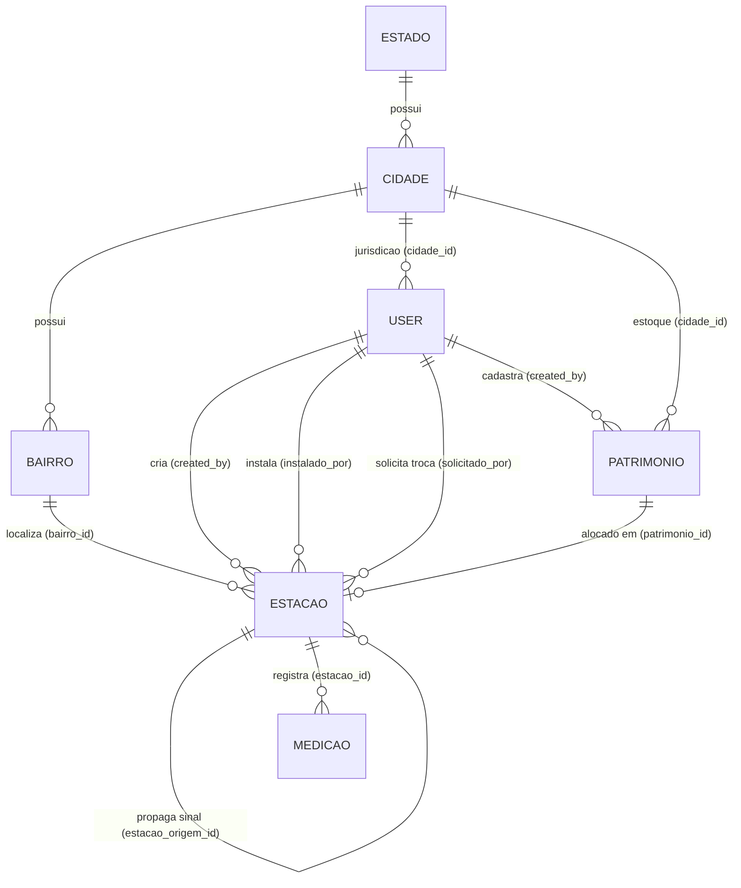

# Documento de Análise de Requisitos — OpenAir-Metrics

## Visão Geral do Módulo

O **OpenAir-Metrics** é uma plataforma web e de telemetria IoT desenvolvida em **Laravel 13 (PHP 8.5)** voltada ao planejamento geoespacial, implantação em campo, gestão patrimonial e monitoramento ambiental em tempo real da qualidade do ar urbano.

Arquiteturalmente, o sistema adota o padrão **MVC orientado a serviços de domínio**, combinando:
- **Ingestão de Telemetria e Broadcasting em Tempo Real:** Recepção de leituras de sensores em campo via API REST ([`MedicaoApiController`](file:///home/henrique_1/Documents/OpenAir-Metrics/app/Http/Controllers/Api/MedicaoApiController.php#L12-L113)), cálculo automatizado do Índice de Qualidade do Ar (IQA) em [`Medicao`](file:///home/henrique_1/Documents/OpenAir-Metrics/app/Models/Medicao.php#L11-L150) e difusão imediata via WebSockets ([`NovaMedicaoRecebida`](file:///home/henrique_1/Documents/OpenAir-Metrics/app/Events/NovaMedicaoRecebida.php#L14-L79)) com Laravel Reverb.
- **Motor Geoespacial e Planejamento de Malha em Cascata:** Cálculo de malhas de estações (Matrizes e Satélites) posicionadas sobre o eixo de vias públicas ([`PlanejamentoMalhaService`](file:///home/henrique_1/Documents/OpenAir-Metrics/app/Services/PlanejamentoMalhaService.php#L12-L757) e [`GeocodingService`](file:///home/henrique_1/Documents/OpenAir-Metrics/app/Services/GeocodingService.php#L13-L626)), utilizando indexação espacial (`POINT` e `LINESTRING` SRID 4326), projeção ortogonal (*Snap to Road*), detecção de colisão (*Anti-Overlap*) e ordenação topológica em árvore via busca em profundidade (DFS) ([`Estacao::ordenarEmCascata`](file:///home/henrique_1/Documents/OpenAir-Metrics/app/Models/Estacao.php#L647-L740)).
- **Gestão Multi-Jurisdicional (Escopo Municipal):** Controle de acesso baseado em papéis (`superadmin`, `administrador`, `cadastrador`/`planejador`, `instalador`) com isolamento de dados por município (`cidade_id`) para inventário de hardware ([`PatrimonioController`](file:///home/henrique_1/Documents/OpenAir-Metrics/app/Http/Controllers/PatrimonioController.php#L14-L285)), ordens de instalação em campo ([`InstalacaoController`](file:///home/henrique_1/Documents/OpenAir-Metrics/app/Http/Controllers/InstalacaoController.php#L14-L322)) e ciclo de vida/substituição de sensores ([`EstacaoController`](file:///home/henrique_1/Documents/OpenAir-Metrics/app/Http/Controllers/EstacaoController.php#L17-L401)).

---

## Requisitos Funcionais (RF)

### Autenticação, Perfil e Gestão de Usuários
- **RF01 — Autenticação de Usuários:** O sistema deve autenticar usuários ativos por e-mail e senha via [`AuthController::store`](file:///home/henrique_1/Documents/OpenAir-Metrics/app/Http/Controllers/AuthController.php#L23-L56) (`POST /login` em [web.php](file:///home/henrique_1/Documents/OpenAir-Metrics/routes/web.php#L25)), redirecionando o usuário conforme seu perfil (`superadmin` para `/usuarios`, `instalador` para `/instalacoes`, demais para `/dashboard`).
- **RF02 — Encerramento de Sessão:** O sistema deve permitir o encerramento seguro da sessão autenticada com invalidação de sessão e regeneração de token CSRF via [`AuthController::destroy`](file:///home/henrique_1/Documents/OpenAir-Metrics/app/Http/Controllers/AuthController.php#L61-L72) (`POST /logout`).
- **RF03 — Gestão de Perfil Próprio:** O sistema deve permitir que o usuário autenticado edite seu nome e endereço cadastral (e vincule `cidade_id` apenas caso ainda não possua município fixado) via [`PerfilController::edit`](file:///home/henrique_1/Documents/OpenAir-Metrics/app/Http/Controllers/PerfilController.php#L15-L25) e [`PerfilController::update`](file:///home/henrique_1/Documents/OpenAir-Metrics/app/Http/Controllers/PerfilController.php#L30-L59) (`GET/PUT /perfil`).
- **RF04 — Administração de Usuários e Administradores Municipais:** O sistema deve permitir a listagem, busca, filtragem, criação, edição e ativação/desativação de contas via [`UsuarioController`](file:///home/henrique_1/Documents/OpenAir-Metrics/app/Http/Controllers/UsuarioController.php#L14-L361) (`/usuarios`), restringindo o escopo conforme o papel do gestor logado.

### Monitoramento Ambiental e Dashboards
- **RF05 — Mapa Público em Tempo Real:** O sistema deve exibir na página inicial ([`HomeController::index`](file:///home/henrique_1/Documents/OpenAir-Metrics/app/Http/Controllers/HomeController.php#L16-L116), `GET /`) as coordenadas e os indicadores da última medição de todas as estações com leituras registradas (IQA, temperatura, umidade, PM2.5 e $\text{CO}_2$), centralizando o mapa na média geográfica das estações ativas.
- **RF06 — Painel Analítico e Contadores de Alertas:** O sistema deve apresentar no painel principal ([`DashboardController::index`](file:///home/henrique_1/Documents/OpenAir-Metrics/app/Http/Controllers/DashboardController.php#L20-L66), `GET /dashboard`) o total de estações, total de leituras e contadores de alertas ambientais para IQA, Temperatura, Umidade, $\text{CO}_2$ e Material Particulado dentro da jurisdição do usuário.
- **RF07 — Séries Temporais com Granularidade Adaptativa:** O sistema deve fornecer agregações temporais (média, máximo, mínimo, rótulos e classificação qualitativa) filtradas por cidade ou bairro, métrica (`qualidade_ar`, `temperatura`, `umidade`, `poeira`, `co2`) e período (`24h`, `7d`, `30d`, `todos`) via [`DashboardController::dadosGrafico`](file:///home/henrique_1/Documents/OpenAir-Metrics/app/Http/Controllers/DashboardController.php#L71-L275) (`GET /dashboard/graficos`).
- **RF08 — Recepção de Telemetria IoT:** O sistema deve disponibilizar um endpoint de ingestão de medições ([`MedicaoApiController::store`](file:///home/henrique_1/Documents/OpenAir-Metrics/app/Http/Controllers/Api/MedicaoApiController.php#L17-L112), `POST /api/medicoes` em [api.php](file:///home/henrique_1/Documents/OpenAir-Metrics/routes/api.php#L7-L9)) que receba `mac_address`, `temperatura`, `umidade`, `co2` e `poeira`, calcule o IQA, persista a leitura e transmita o evento [`NovaMedicaoRecebida`](file:///home/henrique_1/Documents/OpenAir-Metrics/app/Events/NovaMedicaoRecebida.php#L14-L79) no canal público `medicoes`.

### Gestão de Estações e Ciclo de Vida de Sensores
- **RF09 — Listagem e Filtragem de Estações:** O sistema deve listar as estações da jurisdição do usuário com busca textual (MAC, logradouro, bairro, cidade, número de patrimônio), filtros por tipo e status (`instalada`, `pendente`, `substituicao`) e ordenação (incluindo ordenação pelo percentual de vida útil restante) via [`EstacaoController::index`](file:///home/henrique_1/Documents/OpenAir-Metrics/app/Http/Controllers/EstacaoController.php#L22-L111) (`GET /estacoes`).
- **RF10 — Cadastro Individual de Estação:** O sistema deve permitir o cadastro de uma estação (`Estação Matriz` ou `Estação Satélite`) via [`EstacaoController::store`](file:///home/henrique_1/Documents/OpenAir-Metrics/app/Http/Controllers/EstacaoController.php#L166-L266) (`POST /estacoes`), resolvendo automaticamente o endereço por geocodificação reversa, criando/associando o bairro real, vinculando a topologia de rede e alocando eventual equipamento de patrimônio correspondente ao MAC informado.
- **RF11 — Solicitação de Substituição de Sensores:** O sistema deve permitir registrar solicitações de substituição preventiva ou corretiva para estações instaladas via [`EstacaoController::solicitarSubstituicao`](file:///home/henrique_1/Documents/OpenAir-Metrics/app/Http/Controllers/EstacaoController.php#L271-L322) (`POST /estacoes/{public_id}/solicitar-substituicao`).
- **RF12 — Efetivação de Substituição de Sensor:** O sistema deve permitir substituir o equipamento físico de uma estação por um novo item de patrimônio disponível via [`EstacaoController::substituirSensor`](file:///home/henrique_1/Documents/OpenAir-Metrics/app/Http/Controllers/EstacaoController.php#L329-L400) (`POST /estacoes/{public_id}/substituir-sensor`), descartando o patrimônio anterior, ativando o novo e encerrando a pendência de substituição.

### Planejamento Automático de Malha Viária
- **RF13 — Simulação e Cálculo de Malha em Cascata:** O sistema deve calcular automaticamente o posicionamento de 1 Estação Matriz e de 1 a 20 Estações Satélites ao longo das vias públicas em ramos divergentes via [`PlanejamentoController::calcular`](file:///home/henrique_1/Documents/OpenAir-Metrics/app/Http/Controllers/PlanejamentoController.php#L76-L103) (`POST /estacoes/calcular-malha`) e [`PlanejamentoMalhaService::calcularMalha`](file:///home/henrique_1/Documents/OpenAir-Metrics/app/Services/PlanejamentoMalhaService.php#L28-L165).
- **RF14 — Ajuste Fino sobre Vias Públicas (*Snap to Road*):** O sistema deve fornecer um endpoint para encaixar coordenadas candidatas sobre o segmento de rua válido mais próximo, respeitando o limite de distância até a origem e evitando sobreposição com outras estações, via [`PlanejamentoController::snapToRoad`](file:///home/henrique_1/Documents/OpenAir-Metrics/app/Http/Controllers/PlanejamentoController.php#L108-L141) (`POST /estacoes/snap-to-road`).
- **RF15 — Persistência de Malha Planejada:** O sistema deve salvar em transação atômica toda a topologia planejada (Matriz e Satélites com status `Planejada`, vínculos `matriz_pai_id` e `estacao_origem_id`, e ordem sequencial de instalação normalizada em cascata) via [`PlanejamentoController::salvar`](file:///home/henrique_1/Documents/OpenAir-Metrics/app/Http/Controllers/PlanejamentoController.php#L146-L289) (`POST /estacoes/salvar-malha`).

### Gestão de Patrimônio e Ordens de Instalação em Campo
- **RF16 — Gestão de Inventário de Patrimônio (Individual e em Lote):** O sistema deve listar, filtrar e exibir contadores de estoque (`Disponível`, `Instalada`, `Descartado`) via [`PatrimonioController::index`](file:///home/henrique_1/Documents/OpenAir-Metrics/app/Http/Controllers/PatrimonioController.php#L19-L83), além de permitir o cadastro individual ([`PatrimonioController::store`](file:///home/henrique_1/Documents/OpenAir-Metrics/app/Http/Controllers/PatrimonioController.php#L110-L154)), cadastro em lote de múltiplos MAC Addresses ([`PatrimonioController::storeBatch`](file:///home/henrique_1/Documents/OpenAir-Metrics/app/Http/Controllers/PatrimonioController.php#L159-L242)), consulta de itens disponíveis via JSON ([`PatrimonioController::apiDisponiveis`](file:///home/henrique_1/Documents/OpenAir-Metrics/app/Http/Controllers/PatrimonioController.php#L268-L284)) e baixa lógica para `Descartado` ([`PatrimonioController::destroy`](file:///home/henrique_1/Documents/OpenAir-Metrics/app/Http/Controllers/PatrimonioController.php#L247-L263)).
- **RF17 — Acompanhamento de Ordens de Instalação:** O sistema deve listar as malhas agrupadas por Estação Matriz com contagem total de satélites, satélites instaladas e substituições pendentes ([`InstalacaoController::index`](file:///home/henrique_1/Documents/OpenAir-Metrics/app/Http/Controllers/InstalacaoController.php#L19-L92), `GET /instalacoes`) e exibir o roteiro passo a passo ordenado em cascata ([`InstalacaoController::show`](file:///home/henrique_1/Documents/OpenAir-Metrics/app/Http/Controllers/InstalacaoController.php#L97-L137), `GET /instalacoes/{public_id}`).
- **RF18 — Ativação e Vinculação de Hardware em Campo:** O sistema deve permitir que técnicos instaladores ativem estações em campo vinculando um Número de Patrimônio ou MAC Address via [`InstalacaoController::vincularMac`](file:///home/henrique_1/Documents/OpenAir-Metrics/app/Http/Controllers/InstalacaoController.php#L142-L321) (`POST /instalacoes/{public_id}/vincular-mac`), criando o registro de patrimônio automaticamente caso não exista em estoque.

### Localidades e Geocodificação
- **RF19 — Consulta de Localidades e Importação Sob Demanda de Bairros:** O sistema deve expor endpoints JSON para listagem de estados, cidades (por ID ou UF), bairros e coordenadas de estações em [`LocalidadeController`](file:///home/henrique_1/Documents/OpenAir-Metrics/app/Http/Controllers/LocalidadeController.php#L17-L295). Ao consultar bairros de uma cidade sem registros locais, deve importar automaticamente os bairros via API Overpass do OpenStreetMap ([`LocalidadeController::importarBairrosOverpass`](file:///home/henrique_1/Documents/OpenAir-Metrics/app/Http/Controllers/LocalidadeController.php#L73-L175)).
- **RF20 — Geocodificação Reversa Síncrona e Assíncrona:** O sistema deve resolver endereços a partir de coordenadas (`GET /geocoding/reverse` em [`LocalidadeController::reverse`](file:///home/henrique_1/Documents/OpenAir-Metrics/app/Http/Controllers/LocalidadeController.php#L228-L294) e [`GeocodingService::obterDetalhesEndereco`](file:///home/henrique_1/Documents/OpenAir-Metrics/app/Services/GeocodingService.php#L442-L524)), utilizando cache local, proximidade com estações existentes, malha viária local e resolução na API Nominatim (síncrona ou via fila assíncrona [`ResolveReverseGeocodingJob`](file:///home/henrique_1/Documents/OpenAir-Metrics/app/Jobs/ResolveReverseGeocodingJob.php#L14-L81)).

---

## Requisitos Não Funcionais (RNF)

### Tecnologias, Frameworks e Arquitetura
- **RNF01 — Stack Tecnológica:** Aplicação construída sobre **PHP 8.3+ / 8.5**, **Laravel Framework v13**, **Laravel Sanctum v4**, **Laravel Reverb v1** (WebSockets), **Laravel MCP v0.8** ([`OpenAirMetricsServer`](file:///home/henrique_1/Documents/OpenAir-Metrics/app/Mcp/Servers/OpenAirMetricsServer.php#L13-L26) registrado em [ai.php](file:///home/henrique_1/Documents/OpenAir-Metrics/routes/ai.php#L7)), **Tailwind CSS v4**, **Vite v8**, **Leaflet v1.9** e **Laravel Echo / Pusher JS** ([composer.json](file:///home/henrique_1/Documents/OpenAir-Metrics/composer.json), [package.json](file:///home/henrique_1/Documents/OpenAir-Metrics/package.json)).

### Persistência, Geoprocessamento e Portabilidade de Banco
- **RNF02 — Persistência Geoespacial e Índices Espaciais:** As coordenadas de estações são armazenadas como geometria `POINT` (SRID 4326) na tabela `estacoes` ([`Estacao::booted`](file:///home/henrique_1/Documents/OpenAir-Metrics/app/Models/Estacao.php#L105-L130)) e os eixos viários como `LINESTRING` (SRID 4326) com `SPATIAL INDEX` na tabela `malha_viaria` ([2026_09_02_110000_create_malha_viaria_table.php](file:///home/henrique_1/Documents/OpenAir-Metrics/database/migrations/2026_09_02_110000_create_malha_viaria_table.php#L16-L26)). As consultas espaciais utilizam `MBRIntersects` com *Bounding Box* e `ST_Distance_Sphere` no MariaDB/MySQL ([`GeocodingService::buscarViasProximas`](file:///home/henrique_1/Documents/OpenAir-Metrics/app/Services/GeocodingService.php#L26-L104)).
- **RNF03 — Compatibilidade Híbrida de Driver (MariaDB/MySQL e SQLite):** Todos os recursos espaciais possuem *fallback* transparente em PHP utilizando cálculo ortodrômico de Haversine e parsing de WKT/WKB ([`Estacao::extractCoordinatesFromAttribute`](file:///home/henrique_1/Documents/OpenAir-Metrics/app/Models/Estacao.php#L304-L341), [`GeocodingService::buscarViasProximasSqlite`](file:///home/henrique_1/Documents/OpenAir-Metrics/app/Services/GeocodingService.php#L111-L153)), garantindo execução de testes automatizados em SQLite sem dependência de extensões espaciais de SGBD.
- **RNF04 — Ingestão Massiva de Malha Viária (GDAL/ogr2ogr):** O seeder [`MalhaViariaSeeder`](file:///home/henrique_1/Documents/OpenAir-Metrics/database/seeders/MalhaViariaSeeder.php#L12-L197) realiza o download da base nacional do OpenStreetMap (`brazil-latest.osm.pbf`) e importa as vias para o MariaDB via utilitário nativo `ogr2ogr` em lotes (`-gt 65536`), compilando o índice espacial ao término.

### Segurança e Controle de Acesso
- **RNF05 — Segregação de Identificadores (Chaves Internas vs. Públicas):** As entidades críticas ([`Estacao`](file:///home/henrique_1/Documents/OpenAir-Metrics/app/Models/Estacao.php#L33-L40), [`Medicao`](file:///home/henrique_1/Documents/OpenAir-Metrics/app/Models/Medicao.php#L24-L31), [`Patrimonio`](file:///home/henrique_1/Documents/OpenAir-Metrics/app/Models/Patrimonio.php#L25-L44)) utilizam chave primária inteira autoincremental (`private_id`) exclusivamente para joins e chaves estrangeiras internas, expondo apenas UUIDv4 (`public_id`) em rotas, URLs e payloads de API.
- **RNF06 — Limitação de Taxa (*Rate Limiting*):**
  - O endpoint de login (`POST /login`) é protegido por `throttle:5,1` (máximo de 5 tentativas por minuto) ([web.php](file:///home/henrique_1/Documents/OpenAir-Metrics/routes/web.php#L25)).
  - O endpoint de telemetria (`POST /api/medicoes`) é protegido por `throttle:60,1` (60 requisições por minuto) ([api.php](file:///home/henrique_1/Documents/OpenAir-Metrics/routes/api.php#L8)).
  - O job assíncrono de geocodificação reversa aplica `RateLimiter` estrito de 1 requisição por segundo para a API pública do Nominatim, re-enfileirando com atraso de 2 segundos quando excedido ([`ResolveReverseGeocodingJob::handle`](file:///home/henrique_1/Documents/OpenAir-Metrics/app/Jobs/ResolveReverseGeocodingJob.php#L34-L53)).
- **RNF07 — Autenticidade de Dispositivos IoT em Tempo Constante:** O endpoint [`MedicaoApiController::store`](file:///home/henrique_1/Documents/OpenAir-Metrics/app/Http/Controllers/Api/MedicaoApiController.php#L31-L39) valida o cabeçalho HTTP `X-Sensor-Key` contra a chave configurada em `services.telemetry.key` / `TELEMETRY_API_KEY` utilizando `hash_equals()` para mitigar ataques de temporização (*timing attacks*).

### Desempenho, Resiliência e Confiabilidade
- **RNF08 — Estratégia de Cache em Múltiplas Camadas:**
  - Detalhes de geocodificação reversa são armazenados em cache por **30 dias** (`geocoding_details_{lat}_{lng}`, arredondado em 6 casas decimais) ([`GeocodingService::obterDetalhesEndereco`](file:///home/henrique_1/Documents/OpenAir-Metrics/app/Services/GeocodingService.php#L444-L485)).
  - Consultas de geometrias viárias na API Overpass são armazenadas em cache por **24 horas** ([`PlanejamentoMalhaService::obterViasDoOpenStreetMap`](file:///home/henrique_1/Documents/OpenAir-Metrics/app/Services/PlanejamentoMalhaService.php#L174-L180)).
- **RNF09 — Alta Disponibilidade em Integrações Externas (Failover Overpass):** As consultas externas ao OpenStreetMap Overpass implementam rotação automática de servidores espelho (`overpass.private.coffee`, `overpass-api.de`, `overpass.kumi.systems`, `maps.mail.ru`) com timeouts curtos (6 a 8 segundos) e captura de exceções para não interromper o fluxo do usuário ([`PlanejamentoMalhaService::obterViasDoOpenStreetMap`](file:///home/henrique_1/Documents/OpenAir-Metrics/app/Services/PlanejamentoMalhaService.php#L188-L214), [`LocalidadeController::importarBairrosOverpass`](file:///home/henrique_1/Documents/OpenAir-Metrics/app/Http/Controllers/LocalidadeController.php#L105-L131)).
- **RNF10 — Transacionalidade e Preservação de Histórico:** Operações compostas (salvamento de malha planejada, ativação em campo e substituição de sensores) executam dentro de transações `DB::beginTransaction()` / `DB::commit()`. Equipamentos de patrimônio nunca sofrem exclusão física (`DELETE` no banco) pelo controlador, sendo marcados com status `Descartado` ([`PatrimonioController::destroy`](file:///home/henrique_1/Documents/OpenAir-Metrics/app/Http/Controllers/PatrimonioController.php#L247-L263)).

---

## Regras de Negócio (RN)

### Hierarquia de Perfis, Jurisdição e Sucessão Administrativa
- **RN01 — Segregação de Funções do Super-Usuário (`superadmin`):** O Super-Usuário possui permissão exclusiva para gerenciar usuários de nível `administrador` em qualquer município ([`UsuarioController::index`](file:///home/henrique_1/Documents/OpenAir-Metrics/app/Http/Controllers/UsuarioController.php#L29-L37)). É-lhe expressamente bloqueado (`HTTP 403`) o acesso aos módulos operacionais de Dashboard, Estações, Patrimônios e Instalações.
- **RN02 — Escopo de Jurisdição Municipal (`cidade_id`):** Administradores municipais (`administrador`), Planejadores Técnicos (`cadastrador`/`planejador`) e Instaladores (`instalador`) vinculados a um `cidade_id` só podem visualizar, cadastrar, planejar, ativar ou substituir estações e patrimônios pertencentes ao seu próprio município ([`StoreEstacaoRequest::after`](file:///home/henrique_1/Documents/OpenAir-Metrics/app/Http/Requests/StoreEstacaoRequest.php#L90-L101), [`PatrimonioController::store`](file:///home/henrique_1/Documents/OpenAir-Metrics/app/Http/Controllers/PatrimonioController.php#L117-L120), [`InstalacaoController::vincularMac`](file:///home/henrique_1/Documents/OpenAir-Metrics/app/Http/Controllers/InstalacaoController.php#L155-L160)).
- **RN03 — Regra de Sucessão Administrativa Municipal:** Quando um Administrador Municipal cadastra um novo usuário com nível `administrador` para o seu município, a conta do administrador atual é imediatamente desativada (`ativo = false`), sua sessão é encerrada e ele é desconectado do sistema ([`UsuarioController::store`](file:///home/henrique_1/Documents/OpenAir-Metrics/app/Http/Controllers/UsuarioController.php#L189-L196)).
- **RN04 — Bloqueio de Auto-Desativação:** Nenhum administrador ou super-usuário pode desativar a própria conta ([`UsuarioController::toggleStatus`](file:///home/henrique_1/Documents/OpenAir-Metrics/app/Http/Controllers/UsuarioController.php#L212-L221)). Contas com `ativo = false` são impedidas de autenticar ([`AuthController::store`](file:///home/henrique_1/Documents/OpenAir-Metrics/app/Http/Controllers/AuthController.php#L34)).

### Topologia de Rede, Geoprocessamento e Planejamento de Malha
- **RN05 — Alcance Máximo de Rádio de 200 Metros para Satélites:** Toda `Estação Satélite` deve estar localizada a uma distância máxima estrita de **200 metros** (calculada por Haversine / `ST_Distance_Sphere`) de sua estação de origem (`estacao_origem_id`) ou de uma estação já cadastrada no banco. Não é permitido cadastrar uma Estação Satélite caso não exista nenhuma estação previamente cadastrada ([`StoreEstacaoRequest::after`](file:///home/henrique_1/Documents/OpenAir-Metrics/app/Http/Requests/StoreEstacaoRequest.php#L108-L137)).
- **RN06 — Exclusão de Vias Expressas e Rodovias:** O algoritmo de busca viária e *Snap to Road* proíbe o posicionamento de estações em vias classificadas como `'motorway'`, `'trunk'`, `'motorway_link'` ou `'trunk_link'`, permitindo apenas vias urbanas (`residential`, `tertiary`, `secondary`, `primary` e seus links) ([`GeocodingService::buscarViasProximas`](file:///home/henrique_1/Documents/OpenAir-Metrics/app/Services/GeocodingService.php#L62), [`GeocodingService::snapToRoad`](file:///home/henrique_1/Documents/OpenAir-Metrics/app/Services/GeocodingService.php#L288-L303)).
- **RN07 — Algoritmo de Expansão em Cascata e *Anti-Overlap*:**
  - O planejamento automático aceita entre **1 e 20 satélites** por Matriz, distribuindo-as em **2 ramos** (para 1 a 3 satélites), **3 ramos** (para 4 a 6 satélites) ou **4 ramos** cardeais divergentes (acima de 6 satélites) ([`PlanejamentoMalhaService::gerarMalhaEmCascataPelasRuas`](file:///home/henrique_1/Documents/OpenAir-Metrics/app/Services/PlanejamentoMalhaService.php#L302-L317)).
  - Cada salto na cascata busca pontos discretizados no eixo da rua a uma distância entre **100m e 198m** do pai imediato, exigindo afastamento progressivo em relação à Matriz e distância mínima de **180m a 200m** (*Anti-Overlap*) de qualquer outra estação que não seja o próprio pai ([`PlanejamentoMalhaService::encontrarProximoPontoCascataNaRua`](file:///home/henrique_1/Documents/OpenAir-Metrics/app/Services/PlanejamentoMalhaService.php#L481-L515), [`GeocodingService::snapToRoad`](file:///home/henrique_1/Documents/OpenAir-Metrics/app/Services/GeocodingService.php#L353-L391)).
- **RN08 — Ordenação Topológica em Cascata (DFS):** A sequência de instalação (`ordem_instalacao`) de uma malha é normalizada de `1` a `N` por busca em profundidade (DFS) a partir da `Estação Matriz` (sempre Passo `#1`), garantindo que cada ramo seja percorrido continuamente (`Pai -> Filho -> Neto`) antes de iniciar o próximo ramo ([`Estacao::ordenarEmCascata`](file:///home/henrique_1/Documents/OpenAir-Metrics/app/Models/Estacao.php#L647-L740)).
- **RN09 — Precedência de Instalação em Campo:** Uma `Estação Satélite` só pode ser instalada/ativada em campo por um `instalador` se a sua estação pai imediata (`estacao_origem_id`) já estiver com `status_instalacao = 'Instalada'` ([`InstalacaoController::vincularMac`](file:///home/henrique_1/Documents/OpenAir-Metrics/app/Http/Controllers/InstalacaoController.php#L200-L209)).

### Patrimônio, Vida Útil e Manutenção de Sensores
- **RN10 — Codificação Sequencial de Patrimônio por Município:** Todo equipamento cadastrado recebe um código sequencial único por cidade no formato `OAir-Estacao-<cidade_id>-<XXXX>` (com 4 dígitos preenchidos com zero à esquerda, ex: `OAir-Estacao-1-0001`), calculado a partir do maior sufixo numérico existente para aquele município ([`Patrimonio::gerarProximoCodigo`](file:///home/henrique_1/Documents/OpenAir-Metrics/app/Models/Patrimonio.php#L89-L103)).
- **RN11 — Unicidade e Normalização de MAC Address:** O endereço MAC é normalizado para letras maiúsculas no padrão `AA:BB:CC:DD:EE:FF` e deve ser único tanto na tabela `patrimonios` quanto na tabela `estacoes`. Um patrimônio já vinculado a uma estação ativa não pode ser vinculado a outra estação ([`InstalacaoController::vincularMac`](file:///home/henrique_1/Documents/OpenAir-Metrics/app/Http/Controllers/InstalacaoController.php#L246-L255)).
- **RN12 — Cálculo de Vida Útil de Sensores (5 Anos):** A vida útil nominal dos sensores é de **5 anos** ($5 \times 365,25\text{ dias}$) a contar de `data_instalacao` ([`Estacao::calcularVidaUtil`](file:///home/henrique_1/Documents/OpenAir-Metrics/app/Models/Estacao.php#L465-L511)):
  - Sem `data_instalacao`: Status `Não Instalada` (`100%` restante).
  - `dias_restantes <= 0`: Status `Vencida` (`0%` restante).
  - `1 <= dias_restantes <= 180` (< 6 meses): Status `Crítica (< 6 meses)`.
  - `dias_restantes > 180`: Status `Normal`.
- **RN13 — Regras de Solicitação e Substituição de Sensores:**
  - Apenas estações já instaladas (`data_instalacao != null`) podem receber solicitação de substituição ([`EstacaoController::solicitarSubstituicao`](file:///home/henrique_1/Documents/OpenAir-Metrics/app/Http/Controllers/EstacaoController.php#L286-L290)).
  - Se a vida útil restante for **superior a 20%**, o preenchimento de `motivo_substituicao` (mínimo 3 caracteres) é **obrigatório**; caso seja $\le 20\%$ e não informado, assume automaticamente o valor padrão `"Fim da vida útil da estação"` ([`EstacaoController::solicitarSubstituicao`](file:///home/henrique_1/Documents/OpenAir-Metrics/app/Http/Controllers/EstacaoController.php#L292-L306)).
  - Ao efetivar a substituição (via [`EstacaoController::substituirSensor`](file:///home/henrique_1/Documents/OpenAir-Metrics/app/Http/Controllers/EstacaoController.php#L365-L386) ou [`InstalacaoController::vincularMac`](file:///home/henrique_1/Documents/OpenAir-Metrics/app/Http/Controllers/InstalacaoController.php#L267-L293)), o patrimônio antigo é automaticamente alterado para `Descartado`, o novo patrimônio assume `Instalada`, a `data_instalacao` da estação é renovada para `now()` e as flags de substituição são limpas.

### Telemetria, Cálculo de IQA e Classificações Ambientais
- **RN14 — Validação de Telemetria e Status de Ativação:** O endpoint [`MedicaoApiController::store`](file:///home/henrique_1/Documents/OpenAir-Metrics/app/Http/Controllers/Api/MedicaoApiController.php#L19-L74) aceita leituras apenas dentro dos limites físicos (`temperatura` entre $-50$ e $100\text{ °C}$, `umidade` entre $0$ e $100\%$, `co2` entre $0$ e $50000\text{ ppm}$, `poeira` entre $0$ e $5000\text{ }\mu\text{g/m}^3$) e rejeita (`HTTP 422`) medições de estações cujo `status_instalacao` seja diferente de `'Instalada'`.
- **RN15 — Cálculo do Índice de Qualidade do Ar (IQA):** O IQA é calculado por interpolação linear em [`Medicao::calcularIqa`](file:///home/henrique_1/Documents/OpenAir-Metrics/app/Models/Medicao.php#L103-L149) segundo os padrões CONAMA 506/2024 ($\text{PM}_{2.5}$) e ANVISA RE nº 09/2003 ($\text{CO}_2$), assumindo o maior índice arredondado entre os dois poluentes ($\text{IQA} = \text{round}(\max(\text{IQA}_{\text{PM}}, \text{IQA}_{\text{CO2}}))$), limitado ao teto de $500$:
  $$\text{IQA}_p = I_{\text{inf}} + \frac{I_{\text{sup}} - I_{\text{inf}}}{C_{\text{sup}} - C_{\text{inf}}} \times (C - C_{\text{inf}})$$
  - **N1 — Boa ($0\text{ a }40$):** $\text{PM}_{2.5} \in [0; 15,0]$ | $\text{CO}_2 \in [0; 700]$
  - **N2 — Moderada ($41\text{ a }80$):** $\text{PM}_{2.5} \in (15,0; 50,0]$ | $\text{CO}_2 \in (700; 1000]$
  - **N3 — Ruim ($81\text{ a }120$):** $\text{PM}_{2.5} \in (50,0; 75,0]$ | $\text{CO}_2 \in (1000; 1500]$
  - **N4 — Muito Ruim ($121\text{ a }200$):** $\text{PM}_{2.5} \in (75,0; 125,0]$ | $\text{CO}_2 \in (1500; 2500]$
  - **N5 — Péssima ($201\text{ a }400$):** $\text{PM}_{2.5} \in (125,0; 300,0]$ | $\text{CO}_2 \in (2500; 5000]$
- **RN16 — Limiares de Alertas e Granularidade de Gráficos no Dashboard:**
  - Os contadores de alerta no [`DashboardController::index`](file:///home/henrique_1/Documents/OpenAir-Metrics/app/Http/Controllers/DashboardController.php#L43-L47) contabilizam leituras críticas quando: `poeira > 50` ou `co2 > 1000` (Alerta IQA), `temperatura > 35` ou `< 10` (Alerta Temperatura), `umidade < 30` ou `> 85` (Alerta Umidade).
  - O agrupamento temporal dos gráficos ([`DashboardController::determinarBucketTemporal`](file:///home/henrique_1/Documents/OpenAir-Metrics/app/Http/Controllers/DashboardController.php#L323-L386)) adapta-se automaticamente à amplitude (`spanMinutos`) entre a primeira e a última leitura: $\le 2\text{ min} \to 5\text{s}$; $\le 10\text{ min} \to 15\text{s}$; $\le 120\text{ min} \to 1\text{ min}$; $\le 360\text{ min} \to 5\text{ min}$; $\le 1440\text{ min} \to 15\text{ min}$; $\le 10080\text{ min} \to 1\text{ hora}$; $> 10080\text{ min} \to 1\text{ dia}$.

---

## Modelagem de Domínio

### 1. [`User`](file:///home/henrique_1/Documents/OpenAir-Metrics/app/Models/User.php#L30-L105) (Tabela `users`)
Representa os operadores, gestores municipais, técnicos e super-administradores do sistema.
- **Atributos Críticos:**
  - `id` (PK, bigint)
  - `name` (string), `email` (string, unique), `password` (string, hashed)
  - `nivel` (enum: `'superadmin'`, `'administrador'`, `'cadastrador'`, `'planejador'`, `'instalador'`)
  - `ativo` (boolean, default `true`)
  - `cidade_id` (FK nullable $\to$ `cidades.id`, `nullOnDelete`)
  - `logradouro`, `numero`, `complemento`, `bairro`, `estado` (UF, char 2), `cep`
- **Relacionamentos Primários:**
  - `cidade()`: `BelongsTo` $\to$ [`Cidade`](file:///home/henrique_1/Documents/OpenAir-Metrics/app/Models/Cidade.php#L11-L36)
  - `estacoes()`: `HasMany` $\to$ [`Estacao`](file:///home/henrique_1/Documents/OpenAir-Metrics/app/Models/Estacao.php#L19-L741) (`created_by`)

### 2. [`Estacao`](file:///home/henrique_1/Documents/OpenAir-Metrics/app/Models/Estacao.php#L19-L741) (Tabela `estacoes`)
Entidade central que representa um ponto de monitoramento ambiental (planejado ou instalado em campo) e sua posição na topologia da malha.
- **Atributos Críticos:**
  - `private_id` (PK, bigint) e `public_id` (UUIDv4, unique)
  - `mac_address` (string 17, unique, nullable enquanto planejada)
  - `patrimonio_id` (FK nullable $\to$ `patrimonios.private_id`, `nullOnDelete`)
  - `tipo_estacao` (enum: `'Estação Matriz'`, `'Estação Satélite'`)
  - `status_instalacao` (enum: `'Planejada'`, `'Em Instalação'`, `'Instalada'`, `'Inativa'`)
  - `ordem_instalacao` (unsigned int, nullable — passo na cascata DFS)
  - `matriz_pai_id` (Auto-FK nullable $\to$ `estacoes.private_id`, `nullOnDelete`)
  - `estacao_origem_id` (Auto-FK nullable $\to$ `estacoes.private_id`, `nullOnDelete`)
  - `distancia_origem_metros` (decimal 8,2, nullable)
  - `coordenadas` (geometry `POINT` SRID 4326, exposto virtualmente via accessors/mutators `latitude` e `longitude`)
  - `bairro_id` (FK $\to$ `bairros.id`, `restrictOnDelete`)
  - `logradouro` (formatado em Title Case), `numero`, `bairro_nome`, `cidade_nome`, `estado_uf`, `cep`, `endereco_completo`
  - `data_instalacao` (datetime, nullable), `instalado_por` (FK nullable $\to$ `users.id`)
  - `solicitacao_substituicao` (boolean), `solicitacao_substituicao_em` (datetime), `motivo_substituicao` (text), `solicitado_por` (FK nullable $\to$ `users.id`)
  - `created_by` (FK $\to$ `users.id`, `restrictOnDelete`)
- **Relacionamentos Primários:**
  - `bairro()`: `BelongsTo` $\to$ [`Bairro`](file:///home/henrique_1/Documents/OpenAir-Metrics/app/Models/Bairro.php#L11-L36)
  - `patrimonio()`: `BelongsTo` $\to$ [`Patrimonio`](file:///home/henrique_1/Documents/OpenAir-Metrics/app/Models/Patrimonio.php#L12-L128)
  - `medicoes()`: `HasMany` $\to$ [`Medicao`](file:///home/henrique_1/Documents/OpenAir-Metrics/app/Models/Medicao.php#L11-L150) e `ultimaMedicao()`: `HasOne` (`latestOfMany('data_hora')`)
  - `matrizPai()` e `estacaoOrigem()`: `BelongsTo` $\to$ [`Estacao`](file:///home/henrique_1/Documents/OpenAir-Metrics/app/Models/Estacao.php#L19-L741)
  - `satelitesFilhas()` e `satelitesMalha()`: `HasMany` $\to$ [`Estacao`](file:///home/henrique_1/Documents/OpenAir-Metrics/app/Models/Estacao.php#L19-L741)
  - `criador()`, `instalador()`, `solicitanteSubstituicao()`: `BelongsTo` $\to$ [`User`](file:///home/henrique_1/Documents/OpenAir-Metrics/app/Models/User.php#L30-L105)

### 3. [`Patrimonio`](file:///home/henrique_1/Documents/OpenAir-Metrics/app/Models/Patrimonio.php#L12-L128) (Tabela `patrimonios`)
Representa o ativo físico (placa/sensor IoT) no inventário municipal.
- **Atributos Críticos:**
  - `private_id` (PK, bigint) e `public_id` (UUIDv4, unique)
  - `cidade_id` (FK nullable $\to$ `cidades.id`, `nullOnDelete`)
  - `mac_address` (string 17, unique)
  - `numero_patrimonio` (string 50, nullable, padrão `OAir-Estacao-<cidade_id>-<XXXX>`)
  - `status` (enum: `'Disponível'`, `'Instalada'`, `'Descartado'`)
  - `data_aquisicao` (date, nullable), `observacoes` (text, nullable)
  - `created_by` (FK $\to$ `users.id`, `cascadeOnDelete`)
- **Relacionamentos Primários:**
  - `cidade()`: `BelongsTo` $\to$ [`Cidade`](file:///home/henrique_1/Documents/OpenAir-Metrics/app/Models/Cidade.php#L11-L36)
  - `criador()`: `BelongsTo` $\to$ [`User`](file:///home/henrique_1/Documents/OpenAir-Metrics/app/Models/User.php#L30-L105)
  - `estacao()`: `HasOne` $\to$ [`Estacao`](file:///home/henrique_1/Documents/OpenAir-Metrics/app/Models/Estacao.php#L19-L741) (`patrimonio_id`)

### 4. [`Medicao`](file:///home/henrique_1/Documents/OpenAir-Metrics/app/Models/Medicao.php#L11-L150) (Tabela `medicoes`)
Representa uma leitura de telemetria ambiental enviada por uma estação em um instante de tempo.
- **Atributos Críticos:**
  - `private_id` (PK, bigint) e `public_id` (UUIDv4, unique)
  - `estacao_id` (FK $\to$ `estacoes.private_id`, `cascadeOnDelete`, indexado em conjunto com `data_hora`)
  - `temperatura` (decimal 4,1 — °C)
  - `umidade` (decimal 4,1 — %)
  - `co2` (int — ppm)
  - `poeira` (decimal 6,2 — $\mu\text{g/m}^3$)
  - `iqa` (int, nullable — calculado automaticamente na criação/leitura)
  - `data_hora` (datetime)
- **Relacionamentos Primários:**
  - `estacao()`: `BelongsTo` $\to$ [`Estacao`](file:///home/henrique_1/Documents/OpenAir-Metrics/app/Models/Estacao.php#L19-L741)

### 5. [`MalhaViaria`](file:///home/henrique_1/Documents/OpenAir-Metrics/app/Models/MalhaViaria.php#L8-L21) (Tabela `malha_viaria`)
Base geoespacial de segmentos de ruas importados do OpenStreetMap para suporte ao *Snap to Road* e geração de malhas em cascata.
- **Atributos Críticos:**
  - `id` (PK, bigint)
  - `logradouro` (string 256, nullable, indexado)
  - `tipo_via` (string 50, indexado — classificação `highway` do OSM)
  - `geometria` (geometry `LINESTRING` SRID 4326, com `SPATIAL INDEX`)

### 6. Entidades Geográficas ([`Estado`](file:///home/henrique_1/Documents/OpenAir-Metrics/app/Models/Estado.php#L10-L27), [`Cidade`](file:///home/henrique_1/Documents/OpenAir-Metrics/app/Models/Cidade.php#L11-L36), [`Bairro`](file:///home/henrique_1/Documents/OpenAir-Metrics/app/Models/Bairro.php#L11-L36))
- **[`Estado`](file:///home/henrique_1/Documents/OpenAir-Metrics/app/Models/Estado.php#L10-L27) (`estados`):** `id` (PK), `nome`, `uf` (unique, 2 chars). Possui `cidades()` (`HasMany` $\to$ [`Cidade`](file:///home/henrique_1/Documents/OpenAir-Metrics/app/Models/Cidade.php#L11-L36)).
- **[`Cidade`](file:///home/henrique_1/Documents/OpenAir-Metrics/app/Models/Cidade.php#L11-L36) (`cidades`):** `id` (PK), `estado_id` (FK $\to$ `estados.id`), `nome`. Pertence a `estado()` (`BelongsTo` $\to$ [`Estado`](file:///home/henrique_1/Documents/OpenAir-Metrics/app/Models/Estado.php#L10-L27)) e possui `bairros()` (`HasMany` $\to$ [`Bairro`](file:///home/henrique_1/Documents/OpenAir-Metrics/app/Models/Bairro.php#L11-L36)).
- **[`Bairro`](file:///home/henrique_1/Documents/OpenAir-Metrics/app/Models/Bairro.php#L11-L36) (`bairros`):** `id` (PK), `cidade_id` (FK $\to$ `cidades.id`), `nome`. Pertence a `cidade()` (`BelongsTo` $\to$ [`Cidade`](file:///home/henrique_1/Documents/OpenAir-Metrics/app/Models/Cidade.php#L11-L36)) e possui `estacoes()` (`HasMany` $\to$ [`Estacao`](file:///home/henrique_1/Documents/OpenAir-Metrics/app/Models/Estacao.php#L19-L741)).
