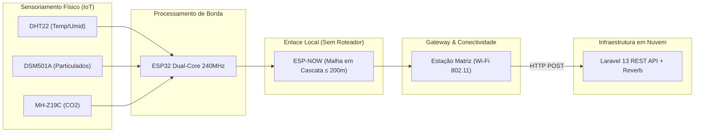
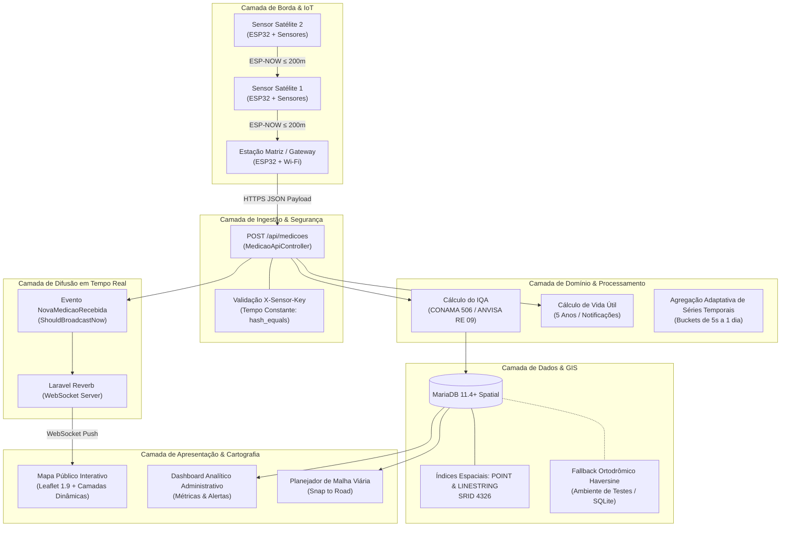
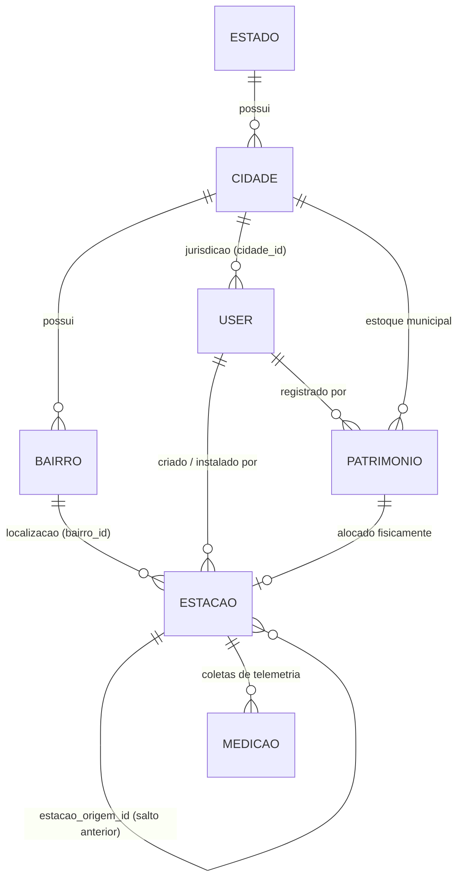
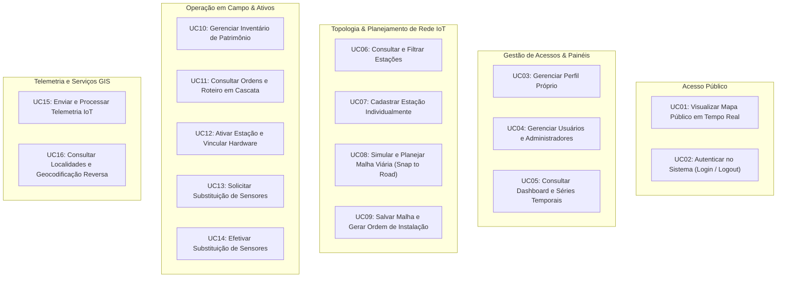

# OpenAir-Metrics

<p align="center">
  <strong>Uma Proposta Sistêmica de Baixo Custo em IoT para Monitoramento Distribuído da Qualidade do Ar</strong>
</p>

<p align="center">
  
  
  
  
  
  
  
  
</p>

---

## 📋 Sumário

- [1. Tema da Pesquisa e Contexto do Projeto](#1-tema-da-pesquisa-e-contexto-do-projeto)
  - [1.1 Problema e Motivação Acadêmica](#11-problema-e-motivação-acadêmica)
  - [1.2 O Papel Central da Internet das Coisas (IoT)](#12-o-papel-central-da-internet-das-coisas-iot)
  - [1.3 Instrumentação Embarcada e Sensores Selecionados](#13-instrumentação-embarcada-e-sensores-selecionados)
  - [1.4 Rede Mesh em Cascata com Protocolo ESP-NOW](#14-rede-mesh-em-cascata-com-protocolo-esp-now)
- [2. Arquitetura da Solução](#2-arquitetura-da-solução)
  - [2.1 Visão Geral Multicamadas do Ecossistema](#21-visão-geral-multicamadas-do-ecossistema)
  - [2.2 Fluxo Ponta a Ponta: Da Captura Física ao Mapa em Tempo Real](#22-fluxo-ponta-a-ponta-da-captura-física-ao-mapa-em-tempo-real)
  - [2.3 Motor Geoespacial e Algoritmo de Planejamento Viário (*Snap to Road*)](#23-motor-geoespacial-e-algoritmo-de-planejamento-viário-snap-to-road)
  - [2.4 Modelagem de Dados e Domínio Espacial](#24-modelagem-de-dados-e-domínio-espacial)
- [3. Requisitos do Sistema](#3-requisitos-do-sistema)
  - [3.1 Requisitos Funcionais (RF01 a RF20)](#31-requisitos-funcionais-rf01-a-rf20)
  - [3.2 Requisitos Não Funcionais (RNF01 a RNF10)](#32-requisitos-não-funcionais-rnf01-a-rnf10)
  - [3.3 Regras de Negócio Fundamentais (RN01 a RN16)](#33-regras-de-negócio-fundamentais-rn01-a-rn16)
- [4. Especificação de Casos de Uso](#4-especificação-de-casos-de-uso)
  - [4.1 Catálogo de Atores do Sistema](#41-catálogo-de-atores-do-sistema)
  - [4.2 Matriz Sintética de Casos de Uso (UC01 a UC16)](#42-matriz-sintética-de-casos-de-uso-uc01-a-uc16)
- [5. Inteligência Ambiental e Cálculo do IQA](#5-inteligência-ambiental-e-cálculo-do-iqa)
  - [5.1 Formulação Matemática do IQA](#51-formulação-matemática-do-iqa)
  - [5.2 Faixas de Qualidade segundo CONAMA e ANVISA](#52-faixas-de-qualidade-segundo-conama-e-anvisa)
- [6. Stack Tecnológica](#6-stack-tecnológica)
- [7. Estrutura do Repositório e Documentação Técnica](#7-estrutura-do-repositório-e-documentação-técnica)

---

## 1. Tema da Pesquisa e Contexto do Projeto

### 1.1 Problema e Motivação Acadêmica

O projeto **OpenAir-Metrics** é resultado de uma pesquisa desenvolvida no âmbito do **Bacharelado em Ciência da Computação** (com concentração em Engenharia de Software) do **Instituto Federal de Educação, Ciência e Tecnologia de São Paulo (IFSP) – Câmpus São João da Boa Vista**, sob autoria de **Henrique Bissoli Malaman Alonso**, orientação do **Prof. Dr. Breno Lisi Romano** e coorientação do **Prof. Me. Everton Rafael da Silva**.

A poluição atmosférica é apontada pela Organização Mundial da Saúde (OMS) e pela Organização das Nações Unidas (ONU) como uma das maiores ameaças ambientais à saúde global, sendo responsável por mais de 7 milhões de mortes prematuras por ano decorrentes de complicações cardiovasculares, pulmonares e neurodegenerativas. No Brasil, embora o Programa Nacional de Controle da Qualidade do Ar (Pronar) exista desde 1989, a infraestrutura oficial de monitoramento é **excessivamente restrita**:
- Menos de **2% dos municípios brasileiros** contam com estações de monitoramento ativas;
- Cerca de **78% das estações existentes** estão concentradas na Região Sudeste;
- O modelo convencional é fundamentado em **estações meteorológicas de referência (macroescala)**, com custo individual de implantação e manutenção na casa de centenas de milhares de reais, impedindo a capilaridade espacial necessária para captar disparidades ambientais hiperlocais.

Nesse contexto, torna-se imperativo o desenvolvimento de soluções em **microescala** que permitam diagnosticar a dispersão de contaminantes em vias urbanas, cruzamentos e perímetros de edifícios públicos (como escolas e postos de saúde), viabilizando tomadas de decisão preventivas pelo poder público e acesso democrático à informação ambiental pela população.

---

### 1.2 O Papel Central da Internet das Coisas (IoT)

A **Internet das Coisas (IoT)** é o pilar estrutural que viabiliza a solução técnica do OpenAir-Metrics. Por meio da integração de microcontroladores de baixo custo, sensores dedicados e arquitetura de comunicação distribuída, a IoT transforma objetos físicos em nós autônomos de sensoriamento contínuo:



As vantagens da abordagem IoT adotada neste projeto abrangem:
1. **Redução Drástica de Custos:** Viabiliza uma estação de monitoramento completa por uma fração mínima do custo de instrumentos tradicionais de referência.
2. **Capilaridade e Resolução Espacial:** Permite criar uma malha densa ao longo do leito de vias públicas urbanas, monitorando variações atmosféricas rua a rua.
3. **Autonomia e Resiliência:** Os nós sensores realizam a leitura contínua e transmitem dados de forma descentralizada.
4. **Configuração Amigável em Campo:** Em sua inicialização de fábrica, o ESP32 emite um Ponto de Acesso (AP) Wi-Fi temporário para que os técnicos em campo configurem credenciais e parâmetros operacionais de forma simplificada.

---

### 1.3 Instrumentação Embarcada e Sensores Selecionados

A seleção tecnológica do hardware priorizou componentes acessíveis no mercado nacional, de consumo elétrico balanceado e acurácia comprovada na literatura científica:

| Componente / Sensor | Parâmetro Mensurado | Faixa Operacional | Resolução / Precisão | Princípio Físico / Químico |
| :--- | :--- | :--- | :--- | :--- |
| **ESP32 DevKit** | *Controlador do Nó* | 2 núcleos Xtensa 32-bit (240 MHz) | 520 KB SRAM / Flash 4MB | Microcontrolador com Wi-Fi b/g/n e BLE nativos |
| **DHT22 (AM2302)** | Temperatura e Umidade | -40 a +80 °C / 0 a 100% RH | ±0,5 °C / ±2% RH | Polímero capacitivo e termistor NTC calibrado |
| **DSM501A (Samyoung)** | Material Particulado ($\text{PM}_{1.0}$ e $\text{PM}_{2.5}$) | Até 15.000 partículas / 283 ml | Partículas a partir de 1 µm | Dispersão óptica de luz (LED + heater térmico + PWM) |
| **MH-Z19C (Winsen)** | Dióxido de Carbono ($\text{CO}_2$) | 400 a 5.000 ppm | ±(50 ppm + 5% leitura) | Infravermelho Não Dispersivo (NDIR) com compensação térmica |

---

### 1.4 Rede Mesh em Cascata com Protocolo ESP-NOW

Um dos maiores desafios de projetos IoT em vias públicas é a ausência de conectividade Wi-Fi aberta contínua em postes ou esquinas. Para superar esse obstáculo sem depender de modems 4G/LTE caros em cada unidade:

1. **Protocolo Connectionless ESP-NOW:** Desenvolvido pela Espressif, opera na frequência industrial de 2.4 GHz sem overhead de associação de rede Wi-Fi convencional. Apresenta tempo de conexão de apenas ~364 µs e transmissão de ~227 µs, com alcance de até 200 metros em visada direta.
2. **Topologia em Cascata Multidirecional:** As **Estações Satélites** transmitem seus pacotes de telemetria diretamente via endereço MAC para a estação imediatamente anterior na malha (`Satélite C -> Satélite B -> Satélite A -> Matriz`).
3. **Nó Concentrador (Estação Matriz / Gateway):** Apenas o nó central da malha (a Estação Matriz) necessita de link ativo com a Internet (via Wi-Fi institucional, comercial ou rede pública). Ele recebe as leituras da malha ESP-NOW e despacha as requisições HTTP REST em lote para a nuvem.

---

## 2. Arquitetura da Solução

### 2.1 Visão Geral Multicamadas do Ecossistema

A plataforma adota o padrão **MVC orientado a serviços de domínio** sobre o ecossistema Laravel 13 e PHP 8.5, garantindo segregação de responsabilidades e alta manutenibilidade:



---

### 2.2 Fluxo Ponta a Ponta: Da Captura Física ao Mapa em Tempo Real

1. **Amostragem Física:** Os sensores DHT22, DSM501A e MH-Z19C realizam a leitura periódica no circuito embarcado. O ESP32 calcula as concentrações de gases e particulados.
2. **Propagação Local:** Caso seja uma Estação Satélite, o payload (máx. 250 bytes) é enviado via ESP-NOW para o nó pai até alcançar a Estação Matriz.
3. **Ingestão HTTP:** A Estação Matriz realiza uma chamada `POST /api/medicoes` transmitindo o JSON com `mac_address`, `temperatura`, `umidade`, `co2` e `poeira`, assinada com o token no header `X-Sensor-Key`.
4. **Validação e Cálculo:** O controlador [`MedicaoApiController`](file:///home/henrique_1/Documents/OpenAir-Metrics/app/Http/Controllers/Api/MedicaoApiController.php#L12-L113) valida os limites físicos das grandezas, confirma a autenticidade via `hash_equals()`, calcula o Índice de Qualidade do Ar (IQA) e grava a medição na tabela `medicoes`.
5. **Broadcasting Instantâneo:** O evento [`NovaMedicaoRecebida`](file:///home/henrique_1/Documents/OpenAir-Metrics/app/Events/NovaMedicaoRecebida.php#L14-L79) despacha imediatamente o novo registro via WebSocket pelo **Laravel Reverb**.
6. **Atualização da Interface:** O cliente conectado na página inicial (Leaflet + Laravel Echo) renderiza o novo ponto geográfico com sua cor representativa de criticidade sem recarregar a tela.

---

### 2.3 Motor Geoespacial e Algoritmo de Planejamento Viário (*Snap to Road*)

O OpenAir-Metrics possui um algoritmo avançado de planejamento urbano implementado em [`PlanejamentoMalhaService`](file:///home/henrique_1/Documents/OpenAir-Metrics/app/Services/PlanejamentoMalhaService.php#L12-L757) e [`GeocodingService`](file:///home/henrique_1/Documents/OpenAir-Metrics/app/Services/GeocodingService.php#L13-L626), responsável por:

1. **Importação e Filtragem de Vias do OpenStreetMap:** Extrai as geometrias viárias locais (`LINESTRING` com SRID 4326), excluindo expressamente rodovias e vias de tráfego pesado (`motorway`, `trunk`), restringindo a malha a vias urbanas (`residential`, `tertiary`, `secondary`, `primary`).
2. **Snapping Ortogonal:** Encaixa a Estação Matriz no segmento de via mais próximo do clique do planejador.
3. **Expansão Multidirecional em Cascata:** Distribui de 1 a 20 Estações Satélites em 2, 3 ou 4 ramos angulares cardeais, projetando nós a saltos de **100m a 198m** de distância do pai imediato.
4. **Mecanismo Anti-Overlap:** Garante que nenhum nó satélite seja posicionado a menos de **180m a 200m** de nós de outros ramos, evitando redundância e interferência.
5. **Ordenação Topológica DFS:** Ordena a instalação em árvore por Busca em Profundidade (`Estacao::ordenarEmCascata`), permitindo que a equipe de campo ative sequencialmente o fluxo de rádio sem quebrar a rota de pacotes.

---

### 2.4 Modelagem de Dados e Domínio Espacial

O banco de dados relacional (MariaDB com extensões espaciais) é estruturado em 4 grandes domínios:



- **Usuários e Localidades:** Tabelas `users`, `estados`, `cidades`, `bairros` e `malha_viaria` (geometrias viárias `LINESTRING`).
- **Infraestrutura e Ativos IoT:** Tabelas `patrimonios` (gestão de ciclo de hardware) e `estacoes` (topologia física, coordenadas `POINT` SRID 4326, autorrelacionamentos de rede).
- **Telemetria Ambiental:** Tabela `medicoes` particionada logicamente com índices compostos por `estacao_id` e `data_hora`.
- **Operações do Framework:** Tabelas `jobs`, `failed_jobs`, `cache`, `sessions` e tokens de autenticação.

---

## 3. Requisitos do Sistema

> 📖 **Documentação Completa de Requisitos:** Consulte os detalhes exaustivos, assinaturas de métodos e regras em [`docs/ANALISE_DE_REQUISITOS.md`](file:///home/henrique_1/Documents/OpenAir-Metrics/docs/ANALISE_DE_REQUISITOS.md).

### 3.1 Requisitos Funcionais (RF01 a RF20)

| Código | Módulo | Descrição Resumida |
| :--- | :--- | :--- |
| **RF01** | Autenticação | Login por e-mail/senha com redirecionamento contextual por perfil (`superadmin`, `instalador`, `administrador`). |
| **RF02** | Autenticação | Encerramento seguro da sessão (Logout) com renovação do token CSRF. |
| **RF03** | Perfil | Visualização e atualização de dados cadastrais e endereço; bloqueio de alteração de cidade após fixada. |
| **RF04** | Usuários | Gestão completa de usuários locais, hierarquia de permissões e regra de sucessão administrativa municipal. |
| **RF05** | Monitoramento | Mapa público em tempo real na página inicial (`GET /`) com IQA, Temperatura, Umidade, $\text{PM}_{2.5}$ e $\text{CO}_2$. |
| **RF06** | Dashboard | Painel analítico municipal com contadores de estações ativas e alertas ambientais críticos. |
| **RF07** | Dashboard | Séries temporais analíticas com agrupamento temporal adaptativo (5 segundos a 1 dia) por cidade/bairro. |
| **RF08** | Telemetria IoT | Ingestão de dados via API REST (`POST /api/medicoes`), validação física de sensores e disparo em WebSocket. |
| **RF09** | Estações | Listagem, busca e filtragem de estações com ordenação por percentual de vida útil restante dos sensores. |
| **RF10** | Estações | Cadastro manual de Estação Matriz e Satélite no mapa, com geocodificação reversa e validação de 200m. |
| **RF11** | Manutenção | Solicitação de substituição preventiva ou corretiva de sensores instalados em campo. |
| **RF12** | Manutenção | Efetivação da substituição de sensores: descarte do hardware antigo e ativação do novo item do estoque. |
| **RF13** | Planejamento | Simulação e cálculo automatizado de malha em cascata viária (1 Matriz e até 20 Satélites) sobre ruas reais. |
| **RF14** | Planejamento | Ajuste fino interativo de estações no mapa com projeção sobre a via mais próxima (*Snap to Road*). |
| **RF15** | Planejamento | Persistência atômica da malha calculada com geração automática de ordem de instalação em árvore (DFS). |
| **RF16** | Patrimônio | Inventário de equipamentos: cadastro individual, importação em lote de MACs e descarte lógico. |
| **RF17** | Instalações | Acompanhamento de ordens de instalação em campo agrupadas por Estação Matriz com roteiro em cascata. |
| **RF18** | Instalações | Ativação física de nós em campo por técnicos instaladores via MAC Address ou código de patrimônio. |
| **RF19** | Localidades | Consulta de estados/cidades/bairros e importação sob demanda de bairros via OpenStreetMap Overpass. |
| **RF20** | Geocodificação | Resolução de endereços geográficos reversos com estratégia de cache e filas assíncronas no Nominatim. |

---

### 3.2 Requisitos Não Funcionais (RNF01 a RNF10)

- **RNF01 — Stack Tecnológica:** PHP 8.5, Laravel 13, Sanctum v4, Reverb v1, Tailwind CSS v4, Leaflet 1.9 e Laravel MCP.
- **RNF02 — Persistência Geoespacial:** Armazenamento em geometrias nativas `POINT` e `LINESTRING` com SRID 4326 e `SPATIAL INDEX` no MariaDB.
- **RNF03 — Compatibilidade Híbrida de Driver:** Mecanismo de contingência automática em PHP (cálculo de Haversine e decodificação WKT/WKB) para testes automatizados em SQLite.
- **RNF04 — Ingestão Massiva de Malha Viária:** Seeder automatizado via `ogr2ogr`/GDAL para importação em lote de bases PBF do OpenStreetMap (`brazil-latest.osm.pbf`).
- **RNF05 — Segregação de Chaves Primárias:** Proteção de chaves internas autoincrementais (`private_id`), expondo unicamente UUIDv4 (`public_id`) em rotas, payloads e links.
- **RNF06 — Limitação de Taxa (*Rate Limiting*):** Proteção multinível contra abusos: `throttle:5,1` no Login; `throttle:60,1` na Telemetria; limite de 1 req/s na geocodificação externa.
- **RNF07 — Autenticação de Dispositivos IoT em Tempo Constante:** Validação do header `X-Sensor-Key` via `hash_equals()` contra ataques de temporização (*timing attacks*).
- **RNF08 — Cache em Múltiplas Camadas:** Cache de 30 dias para geocodificação reversa e cache de 24 horas para geometrias de vias do Overpass.
- **RNF09 — Alta Disponibilidade e Failover:** Rotação de 4 servidores espelho Overpass com timeouts curtos (6 a 8s) para resiliência de rede.
- **RNF10 — Transacionalidade e Preservação de Histórico:** Atomicidade estrita em transações compostas (`DB::beginTransaction`) e descarte lógico de patrimônios (preservação de histórico).

---

### 3.3 Regras de Negócio Fundamentais (RN01 a RN16)

1. **Isolamento de Jurisdição Municipal (RN02):** Todos os dados operacionais (estações, patrimônio, técnicos) são estritamente particionados pelo `cidade_id` do gestor.
2. **Sucessão Administrativa Municipal (RN03):** Quando um administrador municipal cadastra outro administrador para sua cidade, a conta anterior é automaticamente desativada e a sessão encerrada.
3. **Alcance Máximo de Rádio de 200 Metros (RN05):** Nenhuma Estação Satélite pode ser posicionada a uma distância geodésica superior a 200 metros de sua estação pai na malha.
4. **Exclusão de Rodovias (RN06):** É estritamente proibido o posicionamento de nós de monitoramento sobre rodovias e autoestradas (`motorway`, `trunk`).
5. **Precedência na Ativação em Campo (RN09):** Um instalador não pode ativar uma Estação Satélite se o nó pai imediato ainda não estiver com status `Instalada`.
6. **Ciclo de Vida Nominal de 5 Anos (RN12):** Os sensores possuem vida útil de 5 anos; abaixo de 6 meses restantes entram em estado crítico, e com menos de 20% permitem substituição simplificada.

---

## 4. Especificação de Casos de Uso

> 📖 **Documentação Completa de Casos de Uso:** Consulte fluxos principais, caminhos alternativos e códigos HTTP em [`docs/ESPECIFICACAO_CASOS_DE_USO.md`](file:///home/henrique_1/Documents/OpenAir-Metrics/docs/ESPECIFICACAO_CASOS_DE_USO.md).

### 4.1 Catálogo de Atores do Sistema

- 👤 **Visitante:** Cidadão que navega no mapa público de qualidade do ar e na tela de login.
- 👑 **Super-Usuário (`superadmin`):** Administrador global encarregado exclusivamente da criação e gestão de contas de Administradores Municipais.
- 🏛️ **Administrador Municipal (`administrador`):** Gestor responsável por um município específico (`cidade_id`), com autoridade sobre equipes locais, estações e inventário.
- 📐 **Planejador Técnico (`cadastrador` / `planejador`):** Especialista encarregado do desenho de malhas viárias, cadastro de estações e controle de estoque de hardware.
- 🔧 **Instalador (`instalador`):** Técnico em campo que executa o roteiro de ativação física das placas, vinculando MAC Address e número de patrimônio aos pontos planejados.
- 📡 **Sensor IoT (Estação em Campo):** Dispositivo microcontrolado (ESP32) que coleta variáveis ambientais e despacha pacotes de telemetria via REST API.
- 🌐 **APIs OpenStreetMap (Nominatim & Overpass):** Serviços externos integrados para geocodificação reversa e fornecimento de malhas viárias.
- ⚡ **Subsistema Interno (Fila & Reverb):** Processamento assíncrono em segundo plano e servidor de WebSockets para difusão ao vivo.

---

### 4.2 Matriz Sintética de Casos de Uso (UC01 a UC16)



| ID | Nome do Caso de Uso | Atores Primários | Escopo e Responsabilidade Principal |
| :--- | :--- | :--- | :--- |
| **UC01** | Visualizar Mapa Público | Visitante, Reverb | Renderização cartográfica pública com medições e marcadores dinâmicos. |
| **UC02** | Autenticar no Sistema | Visitante, Autenticado | Login seguro, proteção de taxa contra força bruta e roteamento por papel. |
| **UC03** | Gerenciar Perfil Próprio | Usuário Autenticado | Atualização de dados cadastrais e endereço do operador. |
| **UC04** | Gerenciar Usuários | Super-Usuário, Administrador | Cadastro hierárquico com regra estrita de sucessão municipal. |
| **UC05** | Consultar Dashboard | Administrador, Técnico, Instalador | Indicadores de saúde do ar, contadores de alerta e séries temporais adaptativas. |
| **UC06** | Consultar Estações | Administrador, Técnico, Instalador | Tabela operacional com filtros, status e indicador de vida útil nominal. |
| **UC07** | Cadastrar Estação Individual | Planejador, Administrador | Posicionamento pontual no mapa com validação de 200m e geocodificação reversa. |
| **UC08** | Simular Malha em Cascata | Planejador, Administrador | Cálculo automatizado de 1 Matriz e até 20 Satélites sobre ruas reais (*Snap to Road*). |
| **UC09** | Salvar Malha Planejada | Planejador, Administrador | Persistência transacional atômica e ordenação DFS em árvore (`1..N`). |
| **UC10** | Gerenciar Patrimônio | Planejador, Administrador | Cadastro unitário, importação em lote de MACs e descarte lógico de itens. |
| **UC11** | Consultar Ordens de Instalação | Instalador, Planejador | Visualização do roteiro de instalação ordenado topologicamente. |
| **UC12** | Ativar Estação em Campo | Instalador | Vinculação do MAC ou Patrimônio ao ponto físico respeitando a ordem da malha. |
| **UC13** | Solicitar Substituição | Administrador, Planejador | Abertura de ordem de manutenção com justificativa obrigatória (> 20% vida). |
| **UC14** | Efetivar Substituição | Instalador, Planejador | Troca física da placa, descarte do hardware antigo e renovação da vida útil. |
| **UC15** | Enviar Telemetria IoT | Sensor IoT (ESP32), Reverb | Ingestão REST com chave `X-Sensor-Key`, cálculo de IQA e difusão em tempo real. |
| **UC16** | Resolver Geocodificação | Usuário, Fila, APIs OSM | Resolução síncrona/assíncrona de endereços e importação sob demanda de bairros. |

---

## 5. Inteligência Ambiental e Cálculo do IQA

### 5.1 Formulação Matemática do IQA

O Índice de Qualidade do Ar (IQA) sintetiza múltiplas variáveis físico-químicas em uma escala adimensional compreensível. O cálculo é computado por interpolação linear multivariada implementada em [`Medicao::calcularIqa`](file:///home/henrique_1/Documents/OpenAir-Metrics/app/Models/Medicao.php#L103-L149), baseada nas normativas da **Resolução CONAMA nº 506/2024** (para Material Particulado $\text{PM}_{2.5}$) e da **Resolução ANVISA RE nº 09/2003** (para Dióxido de Carbono $\text{CO}_2$):

$$\text{IQA}_p = I_{\text{inf}} + \frac{I_{\text{sup}} - I_{\text{inf}}}{C_{\text{sup}} - C_{\text{inf}}} \times (C - C_{\text{inf}})$$

$$\text{IQA} = \min\left(500, \;\operatorname{round}\left(\max\left(\text{IQA}_{\text{PM}_{2.5}}, \;\text{IQA}_{\text{CO}_2}\right)\right)\right)$$

Onde:
- $C$: Concentração observada do poluente na medição;
- $C_{\text{inf}}, C_{\text{sup}}$: Limites inferior e superior da faixa de concentração do poluente;
- $I_{\text{inf}}, I_{\text{sup}}$: Limites inferior e superior do intervalo do IQA correspondente.

---

### 5.2 Faixas de Qualidade segundo CONAMA e ANVISA

| Nível | Classificação | Faixa IQA | $\text{PM}_{2.5}$ ($\mu\text{g/m}^3$) | $\text{CO}_2$ (ppm) | Efeitos na Saúde e Recomendações |
| :---: | :--- | :---: | :---: | :---: | :--- |
| **N1** | 🟢 **Boa** | 0 – 40 | 0,0 a 15,0 | 0 a 700 | Qualidade ideal do ar; sem riscos à população. |
| **N2** | 🟡 **Moderada** | 41 – 80 | 15,1 a 50,0 | 701 a 1000 | Pessoas de grupos sensíveis podem apresentar sintomas leves. |
| **N3** | 🟠 **Ruim** | 81 – 120 | 50,1 a 75,0 | 1001 a 1500 | Aumento de sintomas respiratórios; recomendada ventilação. |
| **N4** | 🔴 **Muito Ruim** | 121 – 200 | 75,1 a 125,0 | 1501 a 2500 | Agravamento de doenças pulmonares e cardíacas em toda a população. |
| **N5** | 🟣 **Péssima** | 201 – 400 | 125,1 a 300,0 | 2501 a 5000 | Efeitos graves à saúde; recomendada evacuação ou isolamento. |

---

## 6. Stack Tecnológica

| Camada | Tecnologia | Finalidade no Projeto |
| :--- | :--- | :--- |
| **Firmware & Hardware** | **ESP32 (C/C++)** | Microcontrolador de borda com processamento dual-core e baixo consumo. |
| **Rede de Sensores** | **ESP-NOW (2.4 GHz)** | Protocolo peer-to-peer em malha viária (alcance até 200m sem roteador Wi-Fi). |
| **Sensores Físicos** | **DHT22, DSM501A, MH-Z19C** | Aferição de Temperatura, Umidade, Particulados finos ($\text{PM}$) e $\text{CO}_2$. |
| **Framework Backend** | **Laravel 13 (PHP 8.5)** | Núcleo MVC, injeção de dependências, filas assíncronas e API RESTful. |
| **WebSockets & Real-Time** | **Laravel Reverb v1** | Servidor WebSocket nativo de alta performance para transmissão de telemetria. |
| **Banco de Dados Relacional** | **MariaDB 11.4+ / MySQL** | Persistência transacional com suporte geoespacial (`SPATIAL INDEX`). |
| **Banco para Testes** | **SQLite 3** | Execução ágil de testes com fallback Haversine transparente em PHP. |
| **Geoprocessamento** | **GDAL / ogr2ogr** | Ingestão massiva de redes viárias completas a partir de arquivos `.osm.pbf`. |
| **Serviços de Cartografia** | **OpenStreetMap (Nominatim & Overpass)** | Geocodificação reversa e extração de geometria de logradouros urbanos. |
| **Frontend & Estilização** | **Blade & Tailwind CSS v4** | Interface responsiva e moderna com compilação ultra-rápida via Vite v8. |
| **Visualização de Mapas** | **Leaflet v1.9** | Cartografia interativa com camadas de calor e marcadores dinâmicos. |
| **Suíte de Testes** | **Pest PHP v4 & PHPUnit 12** | Testes automatizados de unidade, integração e feature com alta cobertura. |

---

## 7. Estrutura do Repositório e Documentação Técnica

```text
OpenAir-Metrics/
├── app/
│   ├── Events/                     # Eventos de difusão (ex: NovaMedicaoRecebida)
│   ├── Http/
│   │   ├── Controllers/            # Controladores MVC e API de Ingestão de Sensores
│   │   ├── Middleware/             # Controle de autenticação e proteção de rotas
│   │   └── Requests/               # Validações espaciais e regras de negócio (Form Requests)
│   ├── Jobs/                       # Processamento assíncrono (ResolveReverseGeocodingJob)
│   ├── Models/                     # Modelos Eloquent com lógica de domínio e IQA
│   └── Services/                   # Serviços de Geocodificação e Planejamento de Malha
├── config/                         # Configurações de telemetria, reverb, cache e banco
├── database/
│   ├── migrations/                 # Esquemas relacionais e tabelas espaciais (SRID 4326)
│   └── seeders/                    # Carga de dados, malha viária OSM e usuários de teste
├── docs/                           # 📚 Documentação Técnica Exaustiva do Projeto
│   ├── ANALISE_DE_REQUISITOS.md    # Requisitos Funcionais, Não Funcionais e Regras de Negócio
│   └── ESPECIFICACAO_CASOS_DE_USO.md # Especificação Completa dos Casos de Uso (UC01 a UC16)
├── resources/
│   ├── css/                        # Estilos Tailwind CSS v4
│   ├── js/                         # Inicialização do Echo, Reverb e Leaflet
│   └── views/                      # Templates Blade (Home, Dashboard, Estações, etc.)
├── routes/
│   ├── api.php                     # Endpoint seguro de telemetria IoT (/api/medicoes)
│   └── web.php                     # Rotas administrativas, autenticação e mapa público
└── tests/                          # Suíte de testes automatizados com Pest PHP
```
